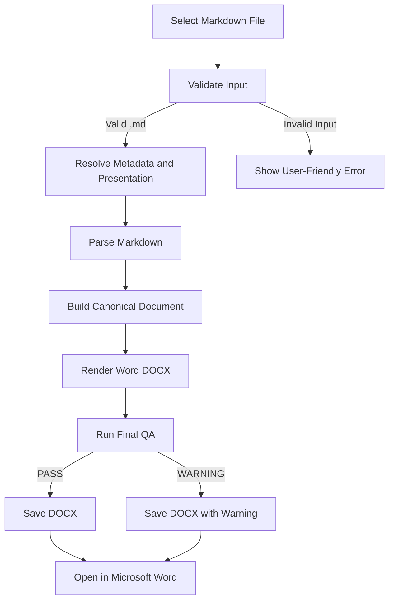

## P24 整体进度

任务总数：6

已报告接受：2
正在进行：1
尚未启动：3

🟩🟩🟨⬜⬜⬜ 33.3%

🟩 已报告接受
🟨 正在进行
⬜ 尚未启动

一、P24 整体进度
主任务数量
6

已报告接受
2

正在进行
1


2 已报告完成

1 进行中

3 未启动


P24-01 已有接受记录；P24-02 沿用此前的 CLOSED/ACCEPTED 记录，但本次未找到其最终 Closure 报告及确切完成日期，需补充核对。进度按六个主任务计数，不代表发行准备完成率。
# MD Converter 2.0 Advanced Feature Acceptance Test

This document is designed for a basic Human Acceptance test of the frozen
MD_Converter 2.0.0-rc.1 Windows GUI build.

It intentionally combines normal Markdown content with several accepted R3
capabilities that are directly expressible in Markdown.

## Executive Summary

MD_Converter should turn this Markdown file into a polished Microsoft Word
document while preserving document structure, readable formatting, and native
Word features.

The document contains:

- YAML frontmatter metadata
- Heading levels 1–3
- A native-TOC-friendly heading hierarchy
- Inline and block equations
- Bold and italic text
- Ordered and unordered lists
- A table
- A block quote
- A fenced code block
- A hyperlink
- Horizontal-rule document structure
- A citation-like no-source control

## 1. Metadata and Heading Structure

The frontmatter at the top of this file defines the document title, date,
author, and tags.

### 1.1 Expected Metadata Behaviour

The metadata should be consumed as document metadata rather than rendered as
ordinary body text.

Check the generated Word document properties where practical.

### 1.2 Heading Hierarchy

This section deliberately uses Heading 1, Heading 2, and Heading 3 levels.

If TOC is enabled by the current conversion configuration, the generated DOCX
should contain a Word-native table of contents derived from this hierarchy.

#### 1.2.1 Level Four Control

This heading is included as a depth-control observation. Whether it appears in
the TOC depends on the configured TOC depth.

## 2. Rich Text and Lists

This sentence contains **bold text**, *italic text*, and `inline code`.

Useful product qualities include:

- local conversion
- private processing
- polished Word output
- no subscription requirement

A simple ordered workflow is:

1. Select a Markdown file.
2. Choose or confirm the output location.
3. Convert the document.
4. Open the generated DOCX in Microsoft Word.
5. Review the result.

> Human Acceptance should focus on whether the resulting document is actually
> pleasant and practical to use, not only whether conversion technically succeeds.

## 3. Table Rendering

| Capability | Expected Result | Human Check |
| --- | --- | --- |
| Metadata | Word document properties populated where supported | PASS / FAIL |
| TOC | Native Word TOC when enabled | PASS / FAIL |
| Inline equation | Editable Word equation | PASS / FAIL |
| Block equation | Editable Word equation | PASS / FAIL |
| Table | Readable Word table | PASS / FAIL |
| Code block | Preserved and readable | PASS / FAIL |
| Lists | Correct hierarchy and numbering | PASS / FAIL |

The table structure and all cell values should remain readable after conversion.

## 4. Editable Equations

An inline equation should remain inside normal paragraph flow. For example,
Einstein's mass-energy relation is $E = mc^2$.

A second inline example is $a^2 + b^2 = c^2$.

### 4.1 Block Equation

The following equation should render as a native editable Word equation:

$$
E = mc^2
$$

### 4.2 Another Block Equation

$$
a^2 + b^2 = c^2
$$

After conversion, click into the equations in Microsoft Word and confirm that
they behave as Word equations rather than static images.

### 4.3 Complex Equation Capability Matrix — E1 to E9

This section tests the bounded native Word equation capability progressively.
Each formula below is intentionally placed **outside code fences** and uses the
accepted MD_Converter equation delimiters.

| Level | Formula | Capability Under Test | Result |
| --- | --- | --- | --- |
| E1 | `a^2+b^2=c^2` | superscript | PASS / WARNING / FAIL |
| E2 | `\xi` | Greek symbol | PASS / WARNING / FAIL |
| E3 | `\xi \in (a,b)` | Greek + relation | PASS / WARNING / FAIL |
| E4 | `\frac{a}{b}` | fraction | PASS / WARNING / FAIL |
| E5 | `f'(\xi)` | function / prime | PASS / WARNING / FAIL |
| E6 | `\frac{f(b)-f(a)}{b-a}` | nested expression | PASS / WARNING / FAIL |
| E7 | `\qquad` | spacing command | PASS / WARNING / FAIL |
| E8 | `\nabla f=\lambda\nabla g` | operator + Greek | PASS / WARNING / FAIL |
| E9 | full Lagrange Mean Value Theorem | combined complex expression | PASS / WARNING / FAIL |

#### E1 — Superscript

$$
a^2+b^2=c^2
$$

Expected capability: superscript handling.

#### E2 — Greek Symbol

$$
\xi
$$

Expected capability: Greek symbol conversion.

#### E3 — Greek Symbol + Relation

$$
\xi \in (a,b)
$$

Expected capability: Greek symbol plus relation operator.

#### E4 — Fraction

$$
\frac{a}{b}
$$

Expected capability: native fraction structure.

#### E5 — Function / Prime

$$
f'(\xi)
$$

Expected capability: prime notation with a function argument.

#### E6 — Nested Expression

$$
\frac{f(b)-f(a)}{b-a}
$$

Expected capability: fraction containing nested function expressions.

#### E7 — Spacing Command

The actual test expression includes visible operands on both sides of the spacing
command so its effect can be inspected in Word:

$$
a \qquad b
$$

Expected capability: `\qquad` spacing command.

#### E8 — Operator + Greek Symbols

$$
\nabla f=\lambda\nabla g
$$

Expected capability: nabla operator and Greek lambda.

#### E9 — Complete Lagrange Mean Value Theorem

$$
f'(\xi)=\frac{f(b)-f(a)}{b-a}, \qquad \xi \in (a,b)
$$

Expected capability: combined function/prime, Greek symbols, fraction, relation
operator, interval notation, and spacing command.

### 4.4 Inline Complex Equation Control

The same parser should preserve paragraph flow for a bounded inline expression:

There exists $\xi \in (a,b)$ such that the mean-value point lies inside the interval.

### 4.5 Equation Human-Acceptance Recording

After conversion, inspect each E1–E9 result in Microsoft Word.

For every level record:

- **PASS** — rendered as a native editable Word equation with the intended meaning.
- **WARNING** — conversion completed with a diagnostic/fallback; record the warning text.
- **FAIL** — missing, corrupted, materially incorrect, or conversion failed.

Also check whether clicking the result in Word enters native Equation editing rather
than selecting ordinary text or an image.

## 5. Code Block

The following fenced code block should remain distinct from ordinary body text:

```python
def convert_markdown(source, output):
    print(f"Converting {source} -> {output}")
    return True
```

The code content should remain unchanged.


## 6. Flowchart Test

This section adds a Mermaid flowchart as a bounded Human Acceptance observation.

The flow describes the normal MD_Converter user journey from Markdown input to
Word output:



### 6.1 Flowchart Human Check

Observe how the frozen RC handles the Mermaid block.

Record one of:

- **RENDERED** — the flowchart appears as an actual diagram in the DOCX.
- **PRESERVED** — Mermaid source is preserved readably as a code block/text.
- **WARNING** — conversion succeeds but reports a diagnostic related to the flowchart.
- **FAIL** — conversion fails, content is lost, or surrounding document structure is corrupted.

For Human Acceptance, unsupported Mermaid rendering is not automatically a defect
unless flowchart rendering is part of the frozen product contract. The important
baseline is that unsupported content is handled deterministically without silent
content loss or document corruption.

## 7. Link Handling

This is a standard Markdown link to
[OpenAI](https://www.openai.com/).

The visible link text should remain readable in the generated document.

---

## 8. Document Structure After a Horizontal Rule

This section appears after a Markdown horizontal rule.

The rule should preserve valid document structure and should not corrupt the
surrounding paragraphs or headings.

### 8.1 Page Flow Observation

Check for:

- unexpected blank pages
- clipped text
- overlapping content
- broken table layout
- strange equation positioning
- inconsistent heading spacing

## 9. Citation-Like No-Source Control

The following text deliberately looks like a supported bibliographic citation:

[@smith2024]

For the packaged GUI Human Acceptance test, no bibliography source is supplied.
Therefore this is a **no-source control**: it should not cause a generated
References section or an unexpected bibliography lookup.

A second multi-item example is:

[@smith2024; @doe2023]

Again, without an accepted bibliography input, this test is intended only to
confirm that ordinary packaged conversion remains inert with respect to
bibliography generation.

## 10. Real-World Mini Report

### 10.1 Current Status

The MD_Converter 2.0 release candidate has completed engineering verification
and is now undergoing Human Acceptance.

### 10.2 Example Metrics

| Metric | Result |
| --- | ---: |
| Documents reviewed | 3 |
| Conversion success target | 100% |
| Manual repair target | Minimal |
| Release blocker tolerance | 0 |

### 10.3 Decision Criteria

A Human reviewer should ask:

1. Was the workflow intuitive?
2. Did the DOCX open normally in Microsoft Word?
3. Did the document look professionally usable?
4. Were equations editable?
5. Was the heading hierarchy sensible?
6. Was the table readable?
7. Did any unexpected References section appear?
8. Would I personally use this product for a real Markdown document?

## 11. Human Acceptance Notes

### Launch and Conversion

- Application launch: PASS / FAIL
- File selection: PASS / FAIL
- Conversion: PASS / FAIL
- Output location understandable: PASS / FAIL
- DOCX opens without repair prompt: PASS / FAIL

### Document Quality

- Metadata behaviour: PASS / FAIL
- TOC behaviour: PASS / FAIL / NOT ENABLED
- Heading hierarchy: PASS / FAIL
- Paragraph formatting: PASS / FAIL
- Lists: PASS / FAIL
- Table: PASS / FAIL
- Code block: PASS / FAIL
- Flowchart / Mermaid handling: RENDERED / PRESERVED / WARNING / FAIL
- Inline equations editable: PASS / FAIL
- Block equations editable: PASS / FAIL
- Complex equation matrix E1-E9: record PASS / WARNING / FAIL for each level
- No unexpected bibliography/References section: PASS / FAIL

### Overall Human Judgment

- BLOCKER findings:
- MAJOR findings:
- MINOR findings:
- OBSERVATIONS:
- Overall product impression:
- Would I use this build for a real document? YES / NO

# End of Test Document

If this document converts successfully and is professionally usable in Microsoft
Word, proceed to a second Human Acceptance test using one of your own real
Markdown documents.
